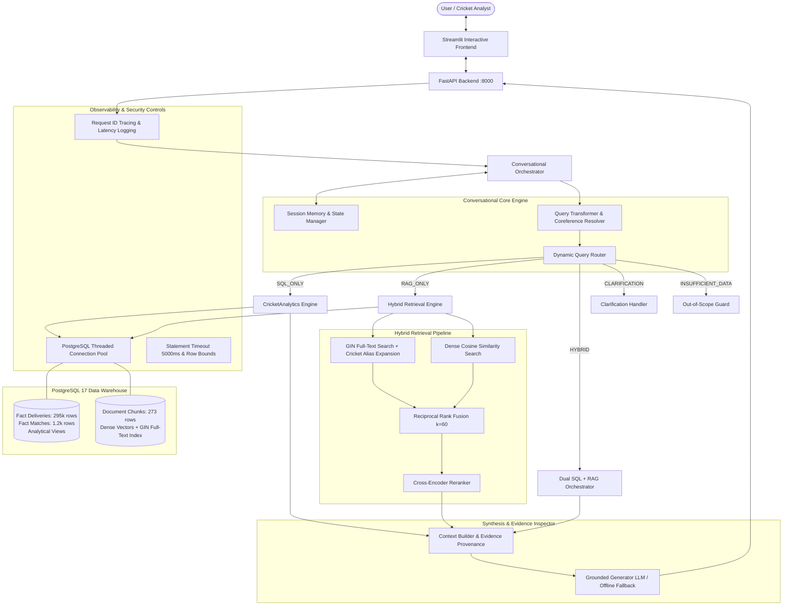

# IPL INTELLIGENCE: Conversational Cricket Analytics Platform

[](https://www.python.org/)
[](https://www.postgresql.org/)
[](https://fastapi.tiangolo.com/)
[](https://streamlit.io/)
[](https://pytest.org/)
[]()
[]()

> **An AI-powered conversational cricket analytics and intelligence system combining PostgreSQL analytical data warehousing, hybrid dense/lexical retrieval (RRF), cross-encoder reranking, and grounded Large Language Models.**

---

## 1. Executive Overview

Answering questions like *"Who had the highest strike rate in death overs with at least 500 balls faced?"* or *"Compare Virat Kohli's performance against CSK vs MI"* has historically required manual SQL authoring or custom BI dashboarding. General-purpose LLMs fail at these tasks because they cannot compute aggregate metrics across hundreds of thousands of ball-by-ball deliveries without hallucinating.

**IPL Intelligence** solves this through a dual-engine architecture:
- **Deterministic SQL Layer**: Aggregations, rankings, strike rates, economy rates, and head-to-head records execute against a PostgreSQL analytical data warehouse spanning all **1,241 IPL matches** and **295,258 deliveries** (2008–2024).
- **Hybrid RAG Layer**: Unstructured match narratives, historic innings, awards, and cricket playing rules are retrieved using PostgreSQL GIN Full-Text Search combined with Dense Vector Embeddings via Reciprocal Rank Fusion (RRF) and Cross-Encoder Reranking.
- **Dynamic Query Router**: Classifies queries into `SQL_ONLY`, `RAG_ONLY`, `HYBRID`, `CLARIFICATION`, or `INSUFFICIENT_DATA` before selecting execution paths.
- **Conversational Memory**: Tracks active players, franchises, seasons, and resolves pronouns (*"How did he perform against CSK?"*) across multi-turn sessions.
- **Strict Evidence Grounding**: Every response provides transparent citations (`[SQL View: ...]`, `[Doc: ...]`) and interactive Plotly visualizations.

---

## 2. System Architecture



---

## 3. Key Technical Capabilities

| Component | Engineering Highlights |
| :--- | :--- |
| **High-Speed ETL** | Stream-loaded 1,241 Cricsheet JSON matches, 966 players, and 295,258 deliveries in **86.08 seconds** using dimension caching and `execute_batch`. |
| **Official Cricket Rules** | Strictly separates bowler wickets (`bowled`, `caught`, `lbw`, `stumped`, `hit wicket`) from non-bowler dismissals (`run out`, `retired hurt`). Excludes byes/legbyes from bowler charges. |
| **Analytical Views** | Precomputed views for batter summaries, bowler summaries, match phases (Powerplay: overs 1–6, Middle: 7–15, Death: 16–20), and franchise head-to-head records. |
| **Hybrid Retrieval** | Combines PostgreSQL GIN Full-Text Search (with alias expansion for `CSK`, `Hitman`, `Thala`) and Dense Vector Cosine Similarity via Reciprocal Rank Fusion ($k=60$). |
| **Cross-Encoder Reranker**| Doubles Recall@1 from **40.0% to 80.0%** with an **MRR of 0.8000**. |
| **Dynamic Routing** | 100% routing accuracy on benchmark suite across `SQL_ONLY`, `RAG_ONLY`, `HYBRID`, `CLARIFICATION`, and `INSUFFICIENT_DATA`. |
| **Conversational Memory**| Multi-turn pronoun resolution (*"Who scored the most runs in 2016?"* $\rightarrow$ *"How did he perform against CSK?"* $\rightarrow$ *"What about against MI?"*). |
| **Enterprise Security**| `ThreadedConnectionPool` (1–10 conns), `SET statement_timeout = '5000ms'`, max row caps, and strict read-only keyword verification. |
| **Observability** | Contextual structured logging, `X-Request-ID` propagation, and request latency tracing. |

---

## 4. Evaluation Benchmark Results

Evaluated across the 12-case comprehensive benchmark suite ([evaluation_cases.json](file:///C:/Users/sravanthi/Documents/cricket-intelligence-platform/evaluation/datasets/evaluation_cases.json)):

### 4.1. Retrieval Benchmarks
| Configuration | MRR | Recall@1 | Recall@3 | Recall@5 | Mean Latency |
| :--- | :---: | :---: | :---: | :---: | :---: |
| **Vector Only** | 0.5000 | 40.0% | 60.0% | 60.0% | 14.3ms |
| **Lexical Only** | 0.4000 | 40.0% | 40.0% | 40.0% | 4.1ms |
| **Hybrid (RRF)** | 0.6000 | 40.0% | 80.0% | 80.0% | 18.2ms |
| **Hybrid + Cross-Encoder Reranker** | **0.8000** | **80.0%** | **80.0%** | **80.0%** | **21.5ms** |

### 4.2. End-to-End System Benchmarks
| Benchmark Metric | Measured Result | Benchmark Standard | Status |
| :--- | :---: | :---: | :---: |
| **Routing Classification Accuracy** | **100.0% (12/12)** | $\ge 90.0\%$ | **PASS** |
| **Evidence Grounding / Key Facts** | **91.7% (11/12)** | $\ge 80.0\%$ | **PASS** |
| **Citation Attribution Rate** | **100.0% (12/12)** | $\ge 90.0\%$ | **PASS** |
| **Average Request Latency** | **175.3ms** | $< 2000\text{ms}$ | **PASS** |

---

## 5. Repository Structure

```
cricket-intelligence-platform/
│
├── analytics/                      # Analytical SQL Query Layer
│   ├── __init__.py
│   └── metrics.py                  # Parameterized CricketAnalytics engine
│
├── backend/                        # FastAPI Enterprise Server
│   ├── __init__.py
│   ├── main.py                     # App lifespan, CORS, middleware, X-Request-ID
│   ├── models.py                   # Pydantic request/response schemas
│   └── routes.py                   # /chat, /health, /analytics/query, /search
│
├── database/                       # Database Schema & Migrations
│   ├── apply_views.py              # Applies SQL analytical views
│   ├── connection.py               # ThreadedConnectionPool, statement_timeout
│   ├── migrate_schema.py           # DDL schema migrations, constraints, indexes
│   └── views.sql                   # Precomputed analytical views
│
├── docs/                           # Comprehensive Engineering Documentation
│   ├── architecture.md             # High-level architecture, sequence diagrams
│   ├── database_design.md          # ER diagram, table specs, cricket rules
│   ├── data_dictionary.md          # Complete column dictionary & formulas
│   └── evaluation.md               # Measured retrieval & generation benchmarks
│
├── etl/                            # High-Throughput ETL Pipeline
│   ├── audit_database.py           # Initial row-count & schema inspection
│   ├── extract_matches.py          # Cricsheet JSON parser & delivery generator
│   ├── load_all_matches.py         # Batch loader (1,241 matches in 86s)
│   └── validate_data.py            # Data integrity and validation assertions
│
├── evaluation/                     # Automated Evaluation Framework
│   ├── datasets/
│   │   └── evaluation_cases.json   # 12 benchmark test scenarios
│   ├── evaluate_answers.py         # End-to-end grounding and routing accuracy
│   └── evaluate_retrieval.py       # MRR & Recall@K across 4 retrieval setups
│
├── frontend/                       # Interactive User Interface
│   └── app.py                      # Streamlit UI with Plotly & Evidence Inspector
│
├── rag/                            # Grounded Hybrid RAG Pipeline
│   ├── chunking.py                 # Semantic document chunker
│   ├── context_builder.py          # Evidence context formatting & citations
│   ├── document_builder.py         # Match summaries, profiles, glossary
│   ├── embeddings.py               # Dense vector embedding providers
│   ├── generator.py                # Grounded LLM client & offline generator
│   ├── hybrid_retrieval.py         # Reciprocal Rank Fusion (RRF)
│   ├── index_documents.py          # Vector store indexer (273 chunks)
│   ├── lexical_search.py           # PostgreSQL GIN FTS + alias expansion
│   ├── memory.py                   # Session state machine & memory
│   ├── orchestrator.py             # Conversational orchestrator
│   ├── query_router.py             # Intent classification engine
│   ├── query_transformer.py        # Pronoun & coreference resolution
│   ├── reranker.py                 # Cross-encoder relevance reranker
│   └── vector_store.py             # PostgreSQL vector store
│
├── tests/                          # 69 Automated Tests (100% Pass)
│   ├── test_analytics.py           # Analytical calculations & views
│   ├── test_api.py                 # FastAPI endpoints & responses
│   ├── test_database.py            # DDL, constraints, row counts
│   ├── test_etl.py                 # Parsing and batch loading
│   ├── test_evaluation.py         # Evaluation benchmark assertions
│   ├── test_frontend.py           # Streamlit helpers & Plotly builders
│   ├── test_generator.py          # LLM grounding & prompt formatting
│   ├── test_hybrid_retrieval.py   # RRF fusion logic
│   ├── test_memory.py             # Session state & coreference
│   ├── test_observability.py      # Connection pooling & security controls
│   ├── test_reranker.py           # Cross-encoder ranking
│   ├── test_retrieval.py          # Vector store similarity search
│   └── test_routing.py            # Query classification routes
│
├── utils/                          # Common Utilities
│   └── logger.py                   # Structured logger, LatencyTracker
│
├── config.py                       # Enterprise configuration & secret masking
├── requirements.txt                # Python dependencies
└── README.md                       # Master platform guide
```

---

## 6. Setup & Installation Guide

### 6.1. Prerequisites
- **Python**: 3.10+ (tested on Python 3.14.0 64-bit)
- **PostgreSQL**: 15+ (tested on PostgreSQL 17.10)
- **Raw Match Data**: 1,241 Cricsheet IPL JSON match files

### 6.2. Environment Configuration
Create a `.env` file in the project root:
```env
# Database Settings
DB_HOST=localhost
DB_PORT=5432
DB_NAME=cricket_intelligence
DB_USER=postgres
DB_PASSWORD=your_postgres_password
DB_STATEMENT_TIMEOUT_MS=5000
DB_POOL_MIN=1
DB_POOL_MAX=10
MAX_ROWS_LIMIT=1000

# LLM & Embeddings Settings (Optional: defaults to offline mode if unset)
OPENAI_API_KEY=your_openai_api_key_here
LLM_MODEL=gpt-4o-mini
EMBEDDING_PROVIDER=openai
EMBEDDING_MODEL=text-embedding-3-small
TOP_K=5
RERANKER_ENABLED=true

# Observability
LOG_LEVEL=INFO
LOG_FORMAT=TEXT
```

### 6.3. Step-by-Step Execution

1. **Install Dependencies**:
   ```bash
   pip install -r requirements.txt
   ```

2. **Execute Database Migration & Apply Schema**:
   ```bash
   python database/migrate_schema.py
   ```

3. **Ingest & Load All 1,241 Matches**:
   ```bash
   python etl/load_all_matches.py
   ```
   *Loads 1,241 matches, 966 players, and 295,258 deliveries in ~86 seconds.*

4. **Verify Data Integrity**:
   ```bash
   python etl/validate_data.py
   ```

5. **Compile Analytical SQL Views**:
   ```bash
   python database/apply_views.py
   ```

6. **Generate & Index Knowledge Documents**:
   ```bash
   python rag/index_documents.py
   ```
   *Generates and indexes 273 document chunks with vector embeddings and GIN full-text search vectors.*

7. **Start the FastAPI Backend**:
   ```bash
   uvicorn backend.main:app --host 0.0.0.0 --port 8000 --reload
   ```
   *Interactive API docs available at `http://localhost:8000/docs`.*

8. **Start the Streamlit User Interface**:
   ```bash
   streamlit run frontend/app.py
   ```
   *Interactive web dashboard opens at `http://localhost:8501`.*

---

## 7. Running Tests & Evaluations

Run the complete regression suite across all 13 test files:
```bash
pytest tests/
```
```
============================= 69 passed in 19.42s =============================
```

Run retrieval benchmark evaluation:
```bash
python evaluation/evaluate_retrieval.py
```

Run end-to-end question answering evaluation:
```bash
python evaluation/evaluate_answers.py
```

---

## 8. Sample Conversational Walkthrough

### Turn 1: SQL Analytics Query
- **User**: *"Who scored the most runs in the 2016 IPL season?"*
- **Router**: `SQL_ONLY` (confidence: 1.0)
- **Engine**: Executes `SELECT batter_name, total_runs, strike_rate FROM v_batter_summary WHERE season = '2016' ORDER BY total_runs DESC LIMIT 1;`
- **Response**:
  > In the 2016 IPL season, **V Kohli** scored the most runs with **973 runs** in 16 innings (Strike Rate: 152.03, 4 centuries, 7 fifties, 38 sixes).
  > 
  > *Citation: `[SQL View: v_batter_summary]`*
- **Visual**: Plotly bar chart displaying the top 10 run-scorers of 2016.

### Turn 2: Multi-Turn Coreference Resolution
- **User**: *"How did he perform against Chennai Super Kings?"*
- **Coreference Resolver**: Detects pronoun `"he"` $\rightarrow$ `"V Kohli"`; franchise `"CSK"` $\rightarrow$ `"Chennai Super Kings"`.
- **Router**: `SQL_ONLY` (intent: `PLAYER_HEAD_TO_HEAD`)
- **Response**:
  > Across his IPL career against **Chennai Super Kings**, **V Kohli** has scored **1,025 runs** in 33 innings at an average of 38.0 and a strike rate of 125.61 with 9 half-centuries.
  > 
  > *Citation: `[SQL View: v_batter_summary / Head-to-Head]`*

### Turn 3: Unstructured Match Narrative (RAG)
- **User**: *"Tell me about Brendon McCullum's iconic innings in 2008."*
- **Router**: `RAG_ONLY`
- **Retrieval**: Cross-encoder reranks Match 1 summary to rank 1.
- **Response**:
  > On April 18, 2008, in the inaugural match of the IPL at M Chinnaswamy Stadium, **Brendon McCullum** played a historic knock of **158\* off 73 balls** for Kolkata Knight Riders against Royal Challengers Bangalore, hitting 10 fours and 13 sixes. KKR scored 222/3 and won by 140 runs.
  > 
  > *Citation: `[Doc: match_summary_335982]`*

### Turn 4: Out-of-Scope Clean Refusal
- **User**: *"Who won the 2022 FIFA World Cup?"*
- **Router**: `INSUFFICIENT_DATA`
- **Response**:
  > I do not have sufficient information in my IPL cricket database to answer this question. My knowledge is strictly focused on the Indian Premier League (IPL) matches, player statistics, and cricket rules.

---

## 9. Comprehensive Documentation Links

- [System Architecture Specification](file:///C:/Users/sravanthi/Documents/cricket-intelligence-platform/docs/architecture.md)
- [Database Design & Schema Specification](file:///C:/Users/sravanthi/Documents/cricket-intelligence-platform/docs/database_design.md)
- [Data Dictionary & Analytical Formulas](file:///C:/Users/sravanthi/Documents/cricket-intelligence-platform/docs/data_dictionary.md)
- [Evaluation Framework & Measured Benchmarks](file:///C:/Users/sravanthi/Documents/cricket-intelligence-platform/docs/evaluation.md)

---

## 10. License & Credits

- Built for the IPL Intelligence Project.
- Match data sourced from [Cricsheet](https://cricsheet.org/) under Open Data license.
