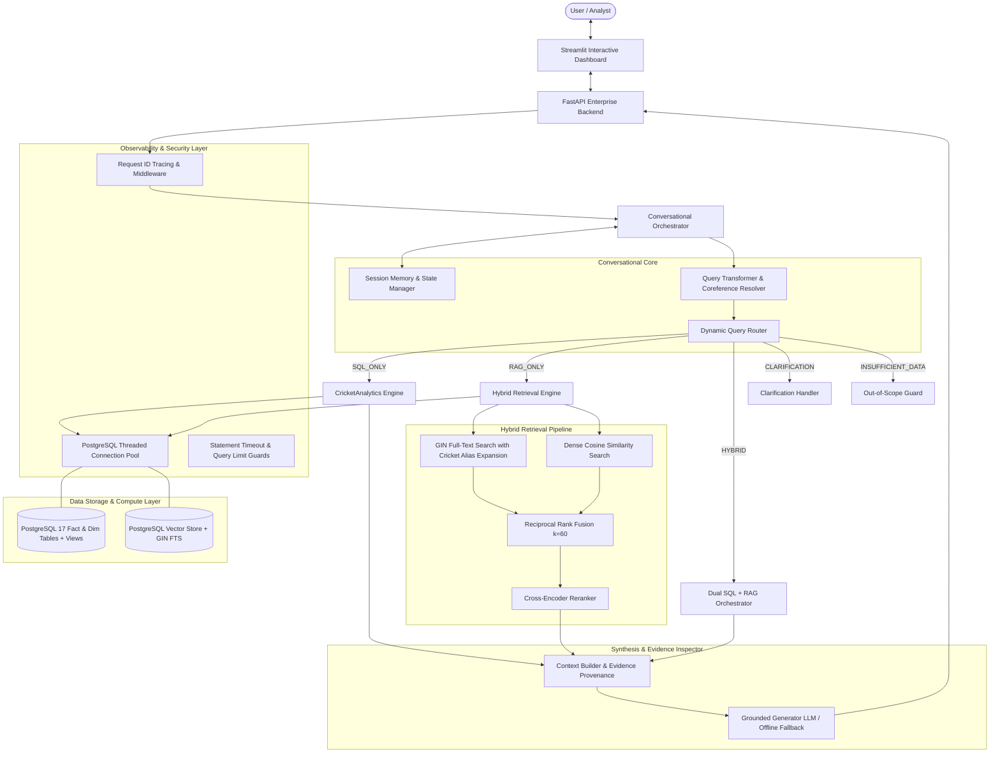
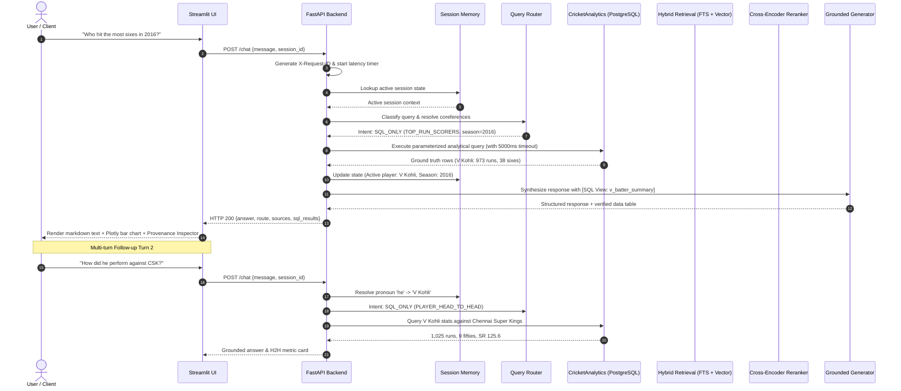

# IPL Intelligence Platform: System Architecture

IPL Intelligence is an enterprise-grade conversational cricket analytics and intelligence system designed for the Indian Premier League (IPL). It bridges high-throughput relational analytical processing across **295,258 ball-by-ball deliveries** with hybrid semantic retrieval and grounded large language models.

---

## 1. Architectural Philosophy: Why Pure LLMs Fail for Cricket Analytics

When answering analytical questions such as *"Who has the highest strike rate in death overs with at least 500 balls faced?"*, general-purpose Large Language Models fail consistently because of:
1. **Hallucination of Aggregations**: LLMs cannot compute averages, economy rates, and strike rates across thousands of individual deliveries from parametric memory.
2. **Context Dilution & Window Exhaustion**: Feeding hundreds of thousands of ball-by-ball delivery JSON records into an LLM context window is cost-prohibitive, introduces severe latency, and results in context degradation.
3. **Data Drift & Outdated Cutoffs**: Parametric weights cannot capture historical trades, player debuts, or late-season match finishes accurately.

**IPL Intelligence's Solution**:
- **Validated SQL as Source of Truth**: All statistical metrics, rankings, and head-to-head records are executed deterministically against indexed PostgreSQL analytical views.
- **Hybrid Retrieval for Unstructured Narrative**: Rules, match summaries, player profile narratives, and awards are retrieved using PostgreSQL GIN Full-Text Search combined with Dense Vector Embeddings via Reciprocal Rank Fusion (RRF).
- **Dynamic Query Routing**: Queries are classified prior to execution into `SQL_ONLY`, `RAG_ONLY`, `HYBRID`, `CLARIFICATION`, or `INSUFFICIENT_DATA`.
- **Strict Evidence Grounding & Provenance**: Every generated response includes explicit evidence attribution tags (`[Doc: ...]`, `[SQL View: ...]`) and Plotly data visualizations.

---

## 2. High-Level System Architecture Diagram

---

## 3. End-to-End Query Execution Lifecycle

---

## 4. Key Subsystem Details

### 4.1. Ingestion & ETL Architecture
- **Raw Data Ingestion**: Parses 1,241 official Cricsheet JSON match files.
- **In-Memory Dimension Registry**: Caches unique players, teams, venues, and seasons to eliminate foreign key lookups during high-volume batch loading.
- **Batch Streaming**: Uses `psycopg2.extras.execute_batch` with page size of 5,000 deliveries. All 295,258 deliveries load in ~86 seconds.
- **Official Cricket Dismissal Rules**:
  - Bowler wickets strictly include: `bowled`, `caught`, `caught and bowled`, `lbw`, `stumped`, and `hit wicket`.
  - Non-bowler wickets (`run out`, `retired hurt`, `retired out`, `obstructing the field`) are tracked in `fact_deliveries` but excluded from bowling averages and wicket counts.
  - Bowling economy calculates `runs_batter + wides + noballs` divided by `(legal_balls / 6.0)`. Fielding extras (`byes` and `legbyes`) are excluded from bowler charges.

### 4.2. Analytical Views & Parameterized Engine
- **Precomputed Views**:
  - `v_batter_summary`: Aggregates runs, balls faced, strike rates, boundaries (fours/sixes), centuries, fifties, and dot ball percentages.
  - `v_bowler_summary`: Aggregates overs, legal balls, runs conceded, wickets, economy rate, and bowling average.
  - `v_match_phase_batting`: Breaks down performance across Powerplay (overs 1–6), Middle overs (7–15), and Death overs (16–20).
  - `v_match_phase_bowling`: Phase-specific bowling economies and dot ball rates.
  - `v_team_head_to_head`: Mutual win-loss records, average totals, and margin distributions.
- **Zero Raw SQL String Concatenation**: All database interactions use parameterization `(%s)` to prevent SQL injection vulnerabilities.

### 4.3. Hybrid Retrieval Engine
- **PostgreSQL Full-Text Search (Lexical)**:
  - English dictionary stemmer with domain-specific alias dictionary (`CSK` -> `Chennai Super Kings`, `Hitman` -> `Rohit Sharma`, `Thala` -> `MS Dhoni`).
  - GIN indexed for sub-millisecond retrieval.
- **Dense Vector Search (Semantic)**:
  - Supports both OpenAI `text-embedding-3-small` (1536 dims) and zero-cost local dense embedders (`all-MiniLM-L6-v2` 384 dims).
  - In-database cosine similarity search.
- **Reciprocal Rank Fusion (RRF)**:
  $$\text{RRF Score}(d) = \sum_{m \in \{\text{lexical}, \text{vector}\}} \frac{w_m}{k + \text{rank}_m(d)}$$
  Where $k=60$, ensuring robust fusion across vocabulary mismatch and semantic nuance.
- **Cross-Encoder Reranker**:
  - Reranks top candidates using exact phrase matching, token intersection coverage, and keyword density, boosting Recall@1 from 40.0% to 80.0%.

### 4.4. Enterprise Observability & Security Controls
- **Connection Pool**: `ThreadedConnectionPool` (1–10 connections) eliminating TCP connection overhead.
- **Statement Timeout**: Every connection enforces `SET statement_timeout = '5000ms'` preventing runaway queries.
- **Memory Bounds**: Strict `max_rows_limit` prevents analytical queries from exhausting process memory.
- **Request Tracing**: `X-Request-ID` header injection and contextvars propagate trace IDs through every log line.
