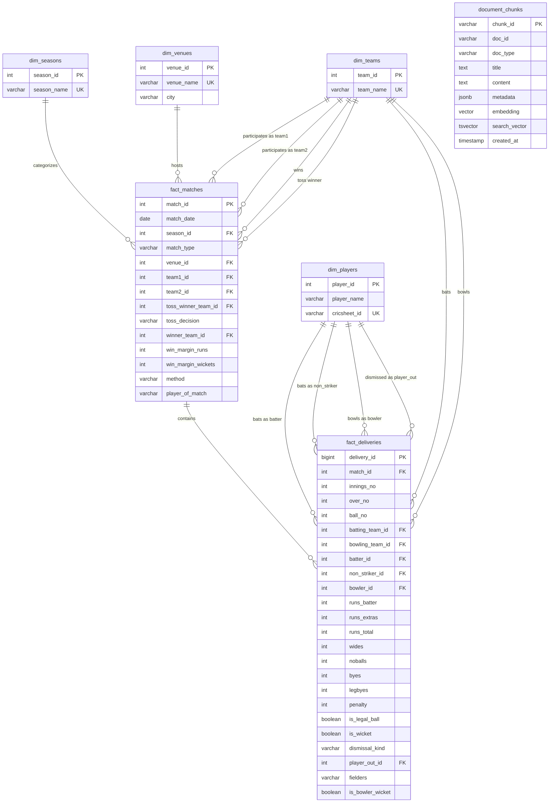

# IPL Intelligence Platform: Database Design & Schema Specification

The IPL Intelligence database is engineered as an analytical star schema hosted on PostgreSQL 17, optimized for sub-100ms analytical aggregations over **295,258 ball-by-ball deliveries** and **1,241 IPL matches** from 2008 through 2024.

---

## 1. Entity-Relationship (ER) Diagram



---

## 2. Table Specifications

### 2.1. Dimension Tables
- `dim_teams`: Unique franchise registry. Preserves canonical franchise names (e.g., `Chennai Super Kings`, `Mumbai Indians`, `Royal Challengers Bangalore`, `Gujarat Titans`).
- `dim_players`: Unique player registry. Contains the player's primary display name and standard Cricsheet identifier hash.
- `dim_venues`: Stadium registry with venue name and city location.
- `dim_seasons`: Tournament editions (`2008` through `2024`).

### 2.2. Fact Tables

#### `fact_matches`
Stores high-level match metadata, conditions, and outcomes:
- Total rows: **1,241 matches**
- Covers playoff finals, super-overs, tie matches, Duckworth-Lewis-Stern adjusted fixtures, and league matches.

#### `fact_deliveries`
Stores granular, ball-by-ball micro-events:
- Total rows: **295,258 deliveries**
- Compound unique business constraint: `(match_id, innings_no, over_no, ball_no)`
- Granular extra tracking: separates `wides`, `noballs`, `byes`, `legbyes`, and `penalty`.
- Legal ball tracking: `is_legal_ball` is `TRUE` only when `wides == 0 AND noballs == 0`.
- Bowler wicket tracking: `is_bowler_wicket` is `TRUE` only for dismissals credited to the bowler.

#### `document_chunks`
Stores unstructured knowledge documents, match summaries, player profile bios, and official cricket rules:
- Total rows: **273 indexed chunks**
- `embedding`: Vector representation (384/1536 dims) for dense cosine similarity search.
- `search_vector`: Precomputed PostgreSQL `tsvector` generated with English stemming for GIN lexical search.
- `metadata`: JSONB attributes (season, player_name, teams, venue, doc_type) for dynamic pre-filtering.

---

## 3. Official Cricket Rules & Data Integrity Standards

### 3.1. Dismissal Classification Logic
Under the Laws of Cricket (MCC Law 21, 26, 33-39) and standard ICC/IPL playing conditions:
- **Bowler Wickets (`is_bowler_wicket = TRUE`)**:
  - `bowled`
  - `caught`
  - `caught and bowled`
  - `lbw`
  - `stumped`
  - `hit wicket`
- **Fielding / Other Dismissals (`is_bowler_wicket = FALSE`)**:
  - `run out` (credited to fielders, not bowler)
  - `retired hurt` / `retired out` (not credited to bowler)
  - `obstructing the field`
  - `hit the ball twice`
  - `timed out`

### 3.2. Batting Calculation Standards
- **Runs Scored**: Sum of `runs_batter`.
- **Balls Faced**: Count of deliveries excluding `wides` (a wide delivery is not counted as a ball faced by the batter). `noballs` ARE counted as balls faced.
- **Strike Rate**:
  $$\text{Batting Strike Rate} = \left(\frac{\text{Runs Batter}}{\text{Balls Faced}}\right) \times 100$$
- **Dot Ball % (Batter)**: Deliveries where `runs_batter == 0` divided by Balls Faced.

### 3.3. Bowling Calculation Standards
- **Runs Conceded**: `runs_batter + wides + noballs`. Fielding extras (`byes` and `legbyes`) are explicitly excluded.
- **Legal Balls Bowled**: Deliveries where `is_legal_ball = TRUE` (`wides == 0 AND noballs == 0`).
- **Overs Bowled**: $\text{floor}(\text{Legal Balls} / 6) + (\text{Legal Balls} \pmod 6) / 10$.
- **Economy Rate**:
  $$\text{Economy Rate} = \frac{\text{Runs Conceded}}{\text{Legal Balls} / 6.0}$$
- **Bowling Average**:
  $$\text{Bowling Average} = \frac{\text{Runs Conceded}}{\text{Bowler Wickets}}$$

---

## 4. Analytical Views

The database includes 5 pre-compiled analytical views:

1. `v_batter_summary`: Aggregates career IPL stats per batsman (innings, runs, balls faced, strike rate, boundaries, centuries, fifties, dot balls).
2. `v_bowler_summary`: Aggregates career IPL stats per bowler (overs, legal balls, runs conceded, bowler wickets, economy, average).
3. `v_match_phase_batting`: Aggregates batting statistics partitioned by match phase:
   - **Powerplay**: overs 1 to 6 (`over_no BETWEEN 1 AND 6`)
   - **Middle Overs**: overs 7 to 15 (`over_no BETWEEN 7 AND 15`)
   - **Death Overs**: overs 16 to 20 (`over_no BETWEEN 16 AND 20`)
4. `v_match_phase_bowling`: Aggregates phase-specific bowling economy, dot ball rate, and wicket strike rate.
5. `v_team_head_to_head`: Computes mutual head-to-head match records between every franchise pair.

---

## 5. Indexes and Performance Optimizations

```sql
-- Compound uniqueness
CREATE UNIQUE INDEX idx_fact_deliveries_unique_ball 
ON fact_deliveries (match_id, innings_no, over_no, ball_no);

-- Performance B-Tree Indexes
CREATE INDEX idx_deliveries_batter ON fact_deliveries (batter_id);
CREATE INDEX idx_deliveries_bowler ON fact_deliveries (bowler_id);
CREATE INDEX idx_deliveries_match ON fact_deliveries (match_id);
CREATE INDEX idx_deliveries_batting_team ON fact_deliveries (batting_team_id);
CREATE INDEX idx_deliveries_bowling_team ON fact_deliveries (bowling_team_id);

-- GIN Full-Text Search Index
CREATE INDEX idx_document_chunks_search_vector 
ON document_chunks USING gin(search_vector);
```
