# IPL Intelligence Platform: Evaluation Framework & Benchmark Results

This document presents the systematic evaluation methodology, experimental setup, and benchmark metrics for both the **Retrieval Layer** and the **End-to-End Conversational Orchestration Layer**.

---

## 1. Evaluation Methodology

A rigorous conversational analytics platform must be evaluated across two distinct dimensions:
1. **Retrieval Performance**: Can the system locate the exact ground-truth documents containing the required cricket context among hundreds of chunks?
2. **System & Generation Performance**: Does the router correctly classify the query? Are the generated responses grounded in factual evidence without hallucinations? Are citations explicitly attributed?

---

## 2. Retrieval Evaluation

### 2.1. Metrics Definitions
- **Mean Reciprocal Rank (MRR)**: Evaluates where the first relevant document appears in the ranked list:
  $$\text{MRR} = \frac{1}{|Q|} \sum_{i=1}^{|Q|} \frac{1}{\text{rank}_i}$$
- **Recall@K**: Proportion of benchmark queries where the ground-truth document is retrieved within the top $K$ results ($K \in \{1, 3, 5\}$).
- **Latency**: Mean retrieval execution time per query in milliseconds.

### 2.2. Configurations Evaluated
1. **Vector Only**: Dense embeddings via cosine similarity (`document_chunks.embedding`).
2. **Lexical Only**: PostgreSQL GIN Full-Text Search with cricket alias expansion (`document_chunks.search_vector`).
3. **Hybrid (RRF)**: Reciprocal Rank Fusion combining Vector + Lexical with constant $k=60$.
4. **Hybrid + Cross-Encoder Reranker**: Hybrid candidate retrieval ($K=8$) followed by cross-encoder re-scoring using token intersection, phrase matching, and density.

### 2.3. Measured Retrieval Benchmark Results

| Retrieval Configuration | MRR | Recall@1 | Recall@3 | Recall@5 | Mean Latency |
| :--- | :---: | :---: | :---: | :---: | :---: |
| **Vector Only** | 0.5000 | 40.0% | 60.0% | 60.0% | 14.3ms |
| **Lexical Only** | 0.4000 | 40.0% | 40.0% | 40.0% | 4.1ms |
| **Hybrid (RRF)** | 0.6000 | 40.0% | 80.0% | 80.0% | 18.2ms |
| **Hybrid + Reranker** | **0.8000** | **80.0%** | **80.0%** | **80.0%** | **21.5ms** |

```mermaid
xychart-beta
    title "Retrieval Metric Comparison Across Configurations"
    x-axis ["Vector Only", "Lexical Only", "Hybrid (RRF)", "Hybrid + Reranker"]
    y-axis "Percentage (%)" 0 --> 100
    bar [40, 40, 40, 80]
    bar [60, 40, 80, 80]
```

*(Blue: Recall@1; Green: Recall@3)*

### 2.4. Key Retrieval Findings
- **Lexical Search Strengths & Weaknesses**: Extremely fast (4.1ms) and captures exact proper nouns (e.g. `BB McCullum`, `Wankhede Stadium`), but completely fails on semantic variations like *"Who has the highest win rate at home?"*.
- **Vector Search Strengths & Weaknesses**: Excels at semantic concepts and cricket terminology (e.g. *"What is a super over?"*), but suffers from name dilution on common cricket words.
- **Hybrid RRF Impact**: Combines the best of both, lifting Recall@3 from 60.0% to 80.0%.
- **Cross-Encoder Reranker Impact**: **Doubles Recall@1 from 40.0% to 80.0%** with an MRR of 0.8000, ensuring the most relevant chunk is placed directly in the top prompt slot.

---

## 3. End-to-End System & Generation Evaluation

### 3.1. Benchmark Dataset
The system was evaluated against a curated benchmark dataset of 12 complex scenarios ([evaluation_cases.json](file:///C:/Users/sravanthi/Documents/cricket-intelligence-platform/evaluation/datasets/evaluation_cases.json)):
- **SQL Analytics Queries**: Aggregations, rankings, death overs, H2H, and player career records.
- **Narrative RAG Queries**: Match narratives, historic innings, awards, and rules.
- **Hybrid Queries**: Combining historical stats with rule explanations.
- **Clarification Queries**: Ambiguous player names requiring user disambiguation.
- **Insufficient Data / Out-of-Scope Queries**: Football or non-IPL queries that must be cleanly refused without hallucination.

### 3.2. Measured Generation & Routing Results

| Metric | Measured Score | Target Threshold | Status |
| :--- | :---: | :---: | :---: |
| **Routing Classification Accuracy** | **100.0% (12/12)** | $\ge 90.0\%$ | Passed |
| **Evidence Grounding / Key Facts** | **91.7% (11/12)** | $\ge 80.0\%$ | Passed |
| **Citation Attribution Rate** | **100.0% (12/12)** | $\ge 90.0\%$ | Passed |
| **Average End-to-End Latency** | **175.3ms** | $< 2000\text{ms}$ | Passed |

### 3.3. Grounding Verification Sample
- **Question**: *"Who hit the most sixes in 2016?"*
  - **Route**: `SQL_ONLY`
  - **Verified Result**: `V Kohli (38 sixes, 973 runs)`
  - **Grounding Citation**: `[SQL View: v_batter_summary]`
- **Question**: *"What is the DLS method?"*
  - **Route**: `RAG_ONLY`
  - **Verified Result**: Correct mathematical target resetting formula under resource percentages.
  - **Grounding Citation**: `[Doc: cricket_glossary_dls]`
- **Question**: *"Who won the 2022 FIFA World Cup?"*
  - **Route**: `INSUFFICIENT_DATA`
  - **Verified Result**: Transparent refusal: *"I do not have data on FIFA World Cup or non-IPL tournaments."*

---

## 4. Automated Regression Verification

The evaluation pipeline is fully codified into the continuous integration test suite:
- `python evaluation/evaluate_retrieval.py`: Runs multi-configuration retrieval benchmarks.
- `python evaluation/evaluate_answers.py`: Runs end-to-end question answering and grounding verification.
- `pytest tests/test_evaluation.py`: Automated CI assertions enforcing MRR $\ge 0.70$ and Routing Accuracy $\ge 90\%$.
